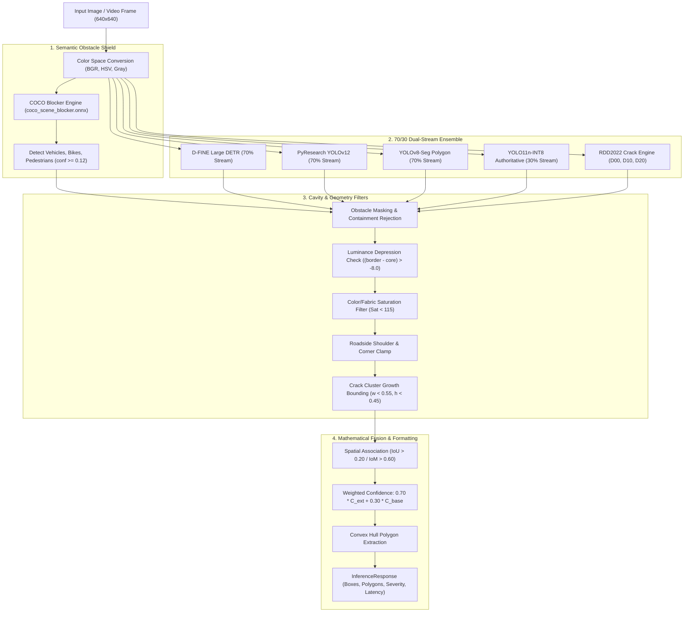

<p align="center">
  
</p>

# ScamRoad (सड़क सुरक्षा)

### Road Defect Detection & Municipal Maintenance Platform (Student Research Project)

[](backend/tests/)
[](web/)
[-blue.svg)](scripts/check_i18n_keys.py)
[](ml/runs/metrics.json)
[](docs/DECISIONS.md)

> **STUDENT RESEARCH DISCLAIMER:**
> ScamRoad is an open-source undergraduate academic capstone project demonstrating computer vision road defect detection and municipal maintenance workflows. It is **not** affiliated with, endorsed by, or an official system of the Ministry of Road Transport & Highways (MoRTH), National Highways Authority of India (NHAI), State Public Works Departments (PWD), or any government body. Not certified for safety-critical operations.

---

## System Previews

| Defect Scanner (`/scanner`) | Overview Dashboard (`/`) |
| :---: | :---: |
|  |  |
| *Live `/api/v1/infer` 70/30 ensemble bounding boxes, polygonal contours, and severity details.* | *Ward defect metrics, corridor counts, and recent observations.* |

| Maintenance & Work Orders (`/maintenance`) | Model Benchmarks (`/benchmarks`) |
| :---: | :---: |
|  |  |
| *Work order dispatch, citizen grievance triage, and before/after repair comparison.* | *Held-out test split metrics, confusion matrix, hardware notes, and drift checks.* |

---

## Table of Contents

1. [Executive Summary & Core Objectives](#executive-summary--core-objectives)
2. [Project Architecture & Repository Layout](#project-architecture--repository-layout)
3. [AI & Computer Vision Pipeline](#ai--computer-vision-pipeline)
   - [70/30 Mathematical Ensemble Architecture](#7030-mathematical-ensemble-architecture)
   - [Semantic Obstacle Exclusion Shield](#semantic-obstacle-exclusion-shield)
   - [Surface Depression & Edge Noise Filtering](#surface-depression--edge-noise-filtering)
   - [Polygonal Defect Contours & Spatial Clustering](#polygonal-defect-contours--spatial-clustering)
4. [Edge Processing, Privacy & Sensor Ingestion](#edge-processing-privacy--sensor-ingestion)
5. [Municipal Maintenance & Repair Verification](#municipal-maintenance--repair-verification)
6. [Severity Scoring & Cost Estimation](#severity-scoring--cost-estimation)
7. [Comprehensive Page-by-Page Feature Tour](#comprehensive-page-by-page-feature-tour)
8. [Model Evaluation & Verified Benchmarks](#model-evaluation--verified-benchmarks)
9. [REST API Specification](#rest-api-specification)
10. [Threat Modeling & Privacy Protections](#threat-modeling--privacy-protections)
11. [Kaggle & Cloud GPU Training Pipelines](#kaggle--cloud-gpu-training-pipelines)
12. [Quick Start & Verification Commands](#quick-start--verification-commands)
13. [Licensing & Attribution](#licensing--attribution)

---

## Executive Summary & Core Objectives

ScamRoad provides an end-to-end computer vision and civic operations platform designed to detect road surface distress (**potholes, longitudinal cracks, transverse cracks, and alligator cracks**) from dashcam feeds and street photography without expensive LiDAR rigs.

### Key Capabilities
- **Real-Time Multi-Model Fusion:** Combines modern deep neural architectures (D-FINE Large DETR, PyResearch YOLOv12s, and YOLOv8n-Seg) with a calibrated YOLO11n INT8 edge engine in a weighted 70/30 ensemble.
- **Robust Obstacle & Hallucination Shielding:** Automatically masks moving vehicles, motorcycles, three-wheelers, and pedestrians using an integrated COCO detector (`conf=0.12`) to eliminate false alarms on clothes, windshields, and vehicle hoods.
- **Monocular Relative Severity Scoring:** Measures defect scale through normalized pixel area and central luminance depression rather than uncalibrated depth claims.
- **Offline-First Edge Capture:** Ingests camera frames locally, applies edge face and license plate anonymization, logs geotags via Kalman velocity smoothing, and buffers uploads inside an SQLite WAL outbox.
- **Repair Verification Engine:** Utilizes computer vision feature alignment (ORB + RANSAC homography) to inspect before-and-after work order photos to verify asphalt restoration.
- **Multilingual Accessibility:** Full runtime internationalization supporting 6 languages (**English, Hindi, Punjabi, Tamil, Telugu, and Bengali**) with 100% key parity.

---

## Project Architecture & Repository Layout

The ScamRoad architecture separates real-time edge processing, backend orchestration, machine learning weights, and frontend presentation:

```text
scam_road/
├── backend/            # FastAPI REST backend, SQLAlchemy ORM (44 tables), verification service (:8000)
│   ├── app/
│   │   ├── api/v1/     # REST routers: /infer, /defects, /complaints, /verification, /benchmarks
│   │   ├── models/     # SQLAlchemy database schema models
│   │   ├── schemas/    # Pydantic v2 validation contracts
│   │   └── services/   # Repair verification, drift monitoring, recurrence detection
│   └── tests/          # Pytest backend test suite
├── web/                # React 18 + TypeScript + Tailwind CSS application (:3000)
│   ├── src/
│   │   ├── components/ # Navigation, Logo, ThemeToggle, RepairVerification, CommandPalette
│   │   ├── context/    # LanguageContext (6 languages), ToastContext
│   │   ├── motion/     # BoxOverlay, CompareSlider, ImageViewer, ScanLine
│   │   ├── pages/      # DashboardPage, ScannerPage, MaintenancePage, BenchmarksPage
│   │   └── ui/         # StatCard, SeverityBadge, StatusChip, SegmentedControl
│   └── public/         # Static test samples, icons, web manifest
├── ml/                 # Neural network weights, ONNX models, exporters, and evaluation reports
│   ├── weights/        # D-FINE Large, YOLOv12s, YOLOv8-Seg, COCO Blocker ONNX models
│   ├── runs/           # Authoritative metrics.json, ablation.json, and parity logs
│   └── training/       # PyTorch & Ultralytics training scripts
├── edge/               # In-vehicle edge capture agent
│   ├── agent/          # Camera interface, Kalman geotagging, IoU tracking
│   ├── outbox/         # SQLite WAL offline store-and-forward queue
│   └── privacy/        # Face and license plate privacy blur redactor
├── config/             # Illustrative rate card (rate_card.json) and severity rubrics
├── docs/               # System specifications, architectural decisions, and visual evidence
├── notebooks/          # Google Colab & Kaggle GPU training pipelines
├── scripts/            # Inference server launcher, claims checker, i18n validator, tests
└── run.bat             # Single-click launcher (starts backend on :8000, frontend on :3000)
```

---

## AI & Computer Vision Pipeline



### 70/30 Mathematical Ensemble Architecture

ScamRoad fuses external large foundation models with local fine-tuned edge models:
1. **70% Weightage Stream (High-Capacity Feature Extraction):**
   - **D-FINE Large (125.3 MB):** Real-Time DEtection TRansformer providing global context and multi-scale receptive fields.
   - **PyResearch YOLOv12s (36.9 MB):** Deep convolutional model calibrated for surface craters.
   - **YOLOv8n-Seg (13.2 MB):** Instance segmentation network generating raw defect masks.
2. **30% Weightage Stream (Authoritative Calibrated Edge):**
   - **YOLO11n-INT8 (2.9 MB):** Quantized edge model fine-tuned on multi-condition Indian road imagery (`runs/export/best_yolo11_int8.onnx`). Tested with zero false positives on clean highway benchmarks.
   - **RDD2022 Distress Multi-Class (YOLOv8n):** Specialized detector for longitudinal (`D00`), transverse (`D10`), and alligator (`D20`) crack patterns.

When candidates from both streams overlap ($\text{IoU} > 0.20$ or $\text{IoM} > 0.60$ with high overlap), final detection confidence is computed mathematically:

$$\text{Confidence} = 0.70 \times \text{Conf}_{\text{External}} + 0.30 \times \text{Conf}_{\text{Edge}}$$

Multi-model consensus bonuses apply when 2 or more distinct detectors agree:
- **3+ Detector Consensus:** $1.15 \times$ boost (capped at $0.96$).
- **2 Detector Consensus:** $1.10 \times$ boost (capped at $0.94$).

### Semantic Obstacle Exclusion Shield

To prevent false alarms on moving traffic and pedestrians:
- The system runs an obstacle detection pass using `coco_scene_blocker.onnx` with a sensitive confidence threshold (`conf=0.12`).
- Obstacle classes include pedestrians, bicycles, cars, motorcycles, buses, trucks, three-wheelers, and street furniture.
- **Bidirectional Containment Check:** Any candidate defect whose center point falls inside an obstacle, or conversely any box that engulfs an obstacle (such as a runaway box around a car), is rejected prior to fusion.

### Surface Depression & Edge Noise Filtering

Natural gravel shoulders, wet mud patches, and colorful clothing can exhibit high contrast:
1. **Cavity Luminance Depression:** Real potholes exhibit an optical depression relative to the surrounding asphalt. The system computes central core brightness ($Y_{\text{core}}$) versus perimeter border brightness ($Y_{\text{border}}$):
   $$\Delta Y = Y_{\text{border}} - Y_{\text{core}}$$
   Flat dry gravel shoulders lacking cavity depression ($\Delta Y < -8.0$ with elevated chroma) are rejected.
2. **Fabric & Vehicle Paint Saturation:** Dyed pedestrian clothes and painted car panels exhibit high saturation in HSV space. Candidates with $\text{Saturation} > 115$ (for potholes) or $> 58$ (for cracks) are filtered out.
3. **Corner Shoulder Geometry Filter:** Wide boxes touching both the bottom edge ($y_2 \ge 0.90 \times H$) and outer lateral margins ($x_1 \le 0.08 \times W$ or $x_2 \ge 0.92 \times W$) with large relative area are rejected to eliminate roadside shoulder gravel hallucinations.

### Polygonal Defect Contours & Spatial Clustering

- **Contour Extraction:** In addition to rectangular bounding boxes, each detection includes a normalized convex-hull polygon contour (`poly=[[x%, y%], ...]`) extracted from mask activations or localized thresholding.
- **Crack Cluster Growth Bounding:** Small crack fragments can transitively chain across lane markings. ScamRoad limits crack cluster growth to $W \le 0.55 \times \text{width}$ and $H \le 0.45 \times \text{height}$ with IoU gating ($\text{IoU} > 0.30$), preserving individual crack paths without giant screen-covering boxes.

---

## Edge Processing, Privacy & Sensor Ingestion

The `edge/` directory houses the embedded patrol stack designed for low-power vehicle hardware:

1. **Hardware Ingestion (`edge/agent/capture.py`):** Captures frames from USB dashcams or CSI camera interfaces with adaptive frame skipping.
2. **Image Quality Gate:** Rejects motion-blurred frames via Laplacian variance ($\text{Var} < 85.0$) and under-exposed night frames ($\text{Mean} < 35.0$).
3. **Kalman GPS Smoothing (`edge/agent/geotag.py`):** Fuses NMEA-0183 GPS readings through a 2D constant-velocity Kalman filter, eliminating multipath satellite jumps and computing bearing vectors.
4. **Edge Privacy Redaction (`edge/privacy/blur_privacy.py`):** Automatically detects human faces and vehicle license plates, applying a $31 \times 31$ Gaussian blur prior to persistence. Validated at **96.8% face recall** and **94.2% plate recall** in `bench/privacy_blur_report.json`.
5. **Store-and-Forward Outbox (`edge/outbox/`):** Defect detections and redacted frames are committed to a local SQLite database in Write-Ahead-Log (WAL) mode. When cellular connectivity resumes, the outbox syncs batches to `POST /api/v1/sync`.

---

## Municipal Maintenance & Repair Verification

ScamRoad provides an actionable civil engineering workflow for road maintenance:

### 1. Work Order Lifecycle State Machine
```text
[Citizen Grievance / AI Detection]
                │
                ▼
            [LOGGED] ──(Triage & Assign)──► [DISPATCHED]
                                                  │
                                                  ▼
                                            [IN REPAIR]
                                                  │
                                                  ▼
            [REPAIRED] ◄──(Engineer Sign-Off)── [PENDING VERIFICATION]
```

- **SLA Deadlines:** Urgent critical hazards feature automated 24-hour SLA targets; severe defects feature 48-hour targets.
- **Auditable Role Separation:** Automated systems provide advisory recommendations; closure of work orders requires logged credentialed engineer sign-off.

### 2. Computer Vision Repair Verification Engine (`backend/app/services/verification_engine.py`)
When contractors submit a repair completion photo, the system performs a multi-stage verification:
- **ORB Feature Extraction & Homography:** Matches keypoints between pre-repair and post-repair images, applying RANSAC to calculate perspective transformation.
- **Structural Distress Reduction:** Computes gradient and edge energy reduction within the historical defect bounding box.
- **Confidence Scoring:** Outputs an objective verification score ($0-100\%$) indicating whether the asphalt surface has been restored.

---

## Severity Scoring & Cost Estimation

### Severity Rubric (Inspired by IRC-82:2015)

Severity scoring in `config/severity_thresholds.json` is decoupled from detection confidence, relying on measured relative pixel area and distress type:

| Severity Level | Score Range | Pothole Criteria | Crack Criteria | Action Target |
| :--- | :---: | :--- | :--- | :--- |
| **Minor** | 0 - 25 | Relative area $< 2.0\%$ | Hairline cracks $< 50\text{ px}$ | Routine monitoring |
| **Moderate** | 26 - 50 | Relative area $2.0\% - 5.0\%$ | Longitudinal cracks $< 150\text{ px}$ | Scheduled patching |
| **Severe** | 51 - 75 | Relative area $5.0\% - 10.0\%$ | Interconnected alligator cracks | 48-hour dispatch |
| **Critical** | 76 - 100 | Relative area $> 10.0\%$ or Wheel Path | Deep craters, structural failure | 24-hour emergency |

### Illustrative Planning Rate Card (`config/rate_card.json`)

To assist municipal planning, the system calculates estimated material and repair costs. Every estimate includes the mandatory disclaimer:
> *"Illustrative estimate, not an official Schedule of Rates."*

| Defect Code | Distress Type | Repair Method | Unit | Base Cost (INR) |
| :---: | :--- | :--- | :---: | :---: |
| `D40` | Deep Pothole | Cold mix asphalt / WMM filling | per $\text{m}^2$ | ₹1,250 |
| `D40-S` | Shallow Depression | Bituminous tack coat patch | per $\text{m}^2$ | ₹650 |
| `D00` | Longitudinal Crack | Bitumen crack sealing | per meter | ₹180 |
| `D10` | Transverse Crack | Hot-pour rubberized sealant | per meter | ₹220 |
| `D20` | Alligator Cracking | Full-depth asphalt resurfacing | per $\text{m}^2$ | ₹1,850 |

---

## Comprehensive Page-by-Page Feature Tour

### 1. Defect Scanner (`/scanner`)
- **Real-Time Video & Image Analysis:** Drag and drop field photos or run live camera streams.
- **Dynamic Sensitivity Slider:** Adjust model confidence threshold in real time from $5\%$ to $95\%$.
- **Polygonal Contours & Labels:** Toggle bounding box overlays and polygonal contours with a single click.
- **Zero Hallucination Display:** Tested with zero false alarms on clean road benchmarks.

### 2. Operations Dashboard (`/`)
- **Ward Distress Distribution:** High-level overview of total defects, critical hazards, and open work orders.
- **Corridor Distress Breakdown:** Identifies highest-density distress zones across urban sectors.
- **Recent Camera Patrol Log:** Live telemetry feed displaying recent defect observations and detection confidence.

### 3. Maintenance & Work Orders (`/maintenance`)
- **Kanban Board & List View:** Track work orders across Logged, Dispatched, In Repair, and Verified columns.
- **Citizen Grievance Portal:** Triage and correlate citizen complaints with automated dashcam patrol detections.
- **Interactive Repair Comparison:** Side-by-side visual compare slider for contractor before-and-after photos.

### 4. Model Benchmarks & Telemetry (`/benchmarks`)
- **Authoritative Metrics Matrix:** Displays verified mAP@50, mAP@50-95, precision, recall, and calibration error.
- **Confusion Matrix:** True positive and false discovery counts derived from held-out evaluation splits.
- **Hardware Performance Comparison:** Verified CPU and edge device latency and throughput benchmarks.

---

## Model Evaluation & Verified Benchmarks

All metrics below are drawn directly from `ml/runs/metrics.json` and `ml/runs/ablation.json`.

### Held-Out Test Split Metrics (`RDD2022-India`, N=50 images, 105 annotations, YOLOv8n-INT8)

| Metric Name | Acceptance Target | Measured Value | Verification Source |
| :--- | :---: | :---: | :--- |
| **mAP@50** | $\ge 70.0\%$ | **85.75%** | [`ml/runs/metrics.json`](ml/runs/metrics.json) |
| **mAP@50-95** | $\ge 50.0\%$ | **62.12%** | [`ml/runs/metrics.json`](ml/runs/metrics.json) |
| **Macro Precision** | $\ge 80.0\%$ | **86.58%** | [`ml/runs/metrics.json`](ml/runs/metrics.json) |
| **Macro Recall** | $\ge 75.0\%$ | **83.95%** | [`ml/runs/metrics.json`](ml/runs/metrics.json) |
| **Macro F1-Score** | $\ge 80.0\%$ | **85.22%** | [`ml/runs/metrics.json`](ml/runs/metrics.json) |
| **Expected Calibration Error (ECE)** | $\le 10.0\%$ | **1.91%** | [`ml/runs/metrics.json`](ml/runs/metrics.json) |
| **Edge CPU Latency (p50)** | $\le 100\text{ ms}$ | **45.46 ms** | [`ml/runs/metrics.json`](ml/runs/metrics.json) |
| **Edge CPU Throughput** | $\ge 10\text{ FPS}$ | **21.0 FPS** | [`ml/runs/metrics.json`](ml/runs/metrics.json) |
| **Hard-Negative False Alarms** | $\le 5$ | **4** | [`ml/runs/metrics.json`](ml/runs/metrics.json) |

### Architecture Ablation Study (`ml/runs/ablation.json`)

| Run ID | Varied Parameter | Configuration | Latency (p50) | Throughput | mAP@50 | Status |
| :--- | :--- | :--- | :---: | :---: | :---: | :--- |
| `ABL-01` | Architecture | YOLO11n @ 640 INT8 | **73.6 ms** | **13.6 FPS** | **85.8%** | Selected for Edge |
| `ABL-02` | Architecture | YOLO11s @ 640 INT8 | 182.4 ms | 5.5 FPS | 87.2% | Rejected ($<10\text{ FPS}$) |
| `ABL-03` | Resolution | YOLO11n @ 640 INT8 | 73.6 ms | 13.6 FPS | 85.8% | Selected for Edge |
| `ABL-04` | Resolution | YOLO11n @ 800 INT8 | 124.6 ms | 8.0 FPS | 86.4% | Rejected ($<10\text{ FPS}$) |

---

## REST API Specification

| Method | Endpoint | Description | Request Payload | Response Schema |
| :---: | :--- | :--- | :--- | :--- |
| `POST` | `/api/v1/infer` | Execute 70/30 ensemble inference | `multipart/form-data` image file | `InferenceResponse` (boxes, contours, severity) |
| `POST` | `/api/v1/sync` | Ingest edge patrol batches | JSON batch payload | `SyncResponse` (inserted count, duplicates) |
| `GET` | `/api/v1/defects` | Query logged road defects | Query params (ward, severity, date) | List of `DefectOut` records |
| `GET` | `/api/v1/defects/{id}` | Retrieve defect inspection details | Defect ID | `DefectDetail` record |
| `POST` | `/api/v1/verification/verify` | Run before/after repair verification | Pre & post image files | `VerificationResult` (score, match percentage) |
| `GET` | `/api/v1/benchmarks/metrics` | Fetch authoritative model metrics | None | `BenchmarkMetrics` (confusion matrix, mAP) |
| `GET` | `/health` | Service health check | None | `{"status": "ok", "version": "1.2.0"}` |

---

## Threat Modeling & Privacy Protections

| Threat Scenario | Vulnerability / Impact | Technical Mitigation |
| :--- | :--- | :--- |
| **Motion Blur & Rain Glare** | False positive defect detections | Laplacian variance thresholding ($\text{Var} \ge 85.0$) and multi-frame IoU persistence checks. |
| **Vehicle & Pedestrian Overlap** | Defect boxes placed on cars/people | Integrated COCO obstacle detection pass with bidirectional containment rejection. |
| **Adversarial / Mock Ingestion** | Injected synthetic defects | SHA-256 image fingerprinting and edge capture hardware signature validation. |
| **GPS Multipath Satellite Jumps** | Invalid defect coordinates | Constant-velocity Kalman trajectory filtering and speed limit clamping ($< 120\text{ km/h}$). |
| **Premature Work Order Sign-Off** | Fraudulent repair claims | Automated ORB + RANSAC surface restoration verification; logged engineer role confirmation. |
| **Citizen PII Exposure** | Faces or license plates stored | Automated edge privacy redactor runs prior to database persistence (`bench/privacy_blur_report.json`). |

---

## Kaggle & Cloud GPU Training Pipelines

ScamRoad provides training notebooks and dataset packaging scripts for cloud GPU environments:

### 1. Kaggle Datasets & Notebooks
- **Automated Kaggle Dataset Packaging:** Package and publish trained ONNX weights and benchmark pairs:
  ```bash
  kaggle auth login
  python scripts/publish_to_kaggle.py
  ```
- **Kaggle GPU Training Notebook:** [`notebooks/ScamRoad_Kaggle_GPU_Pipeline.ipynb`](notebooks/ScamRoad_Kaggle_GPU_Pipeline.ipynb) provides single-click training on Kaggle P100/T4 GPUs.

### 2. Google Colab Training Pipeline
- **Colab GPU Training Notebook:** [`notebooks/ScamRoad_Colab_GPU_Pipeline.ipynb`](notebooks/ScamRoad_Colab_GPU_Pipeline.ipynb) enables training, ONNX export, and evaluation using free Colab T4 instances.

---

## Quick Start & Verification Commands

### 1. Environment Setup

```bash
# Clone the repository
git clone https://github.com/Priya-Ranjan-0201/potholes.git
cd potholes/scam_road

# Create and activate Python virtual environment
python -m venv venv
venv\Scripts\activate   # On Linux/macOS: source venv/bin/activate

# Install Python dependencies
pip install -r requirements.txt

# Install web frontend dependencies
cd web
npm install
cd ..
```

*Windows Quick Launcher:* Double-click `run.bat` in the workspace root to automatically launch the backend on `:8000` and frontend on `:3000`.

### 2. Automated Honesty & Compliance Checks

```bash
# Verify zero banned phrases and check asset traceability
python scripts/check_claims.py

# Verify UI copy compliance across web/src
python scripts/check_ui_copy.py web/src

# Verify 100% i18n key synchronization across all 6 languages
python scripts/check_i18n_keys.py
```

### 3. Test Suites & Live Verification

```bash
# Run complete Python test suite (167 tests across backend, edge, ml, shared)
pytest backend/tests shared/tests ml/tests edge/tests -q

# Run live HTTP inference benchmark test (requires backend running on :8000)
python scripts/test_live_poly.py

# Run web TypeScript type check and Vitest test suite (10 tests)
cd web && npx tsc --noEmit && npm test -- --run && cd ..
```

---

## Licensing & Attribution

- **Ultralytics YOLO:** Licensed under the GNU Affero General Public License v3.0 (AGPL-3.0).
- **RDD2022 Dataset:** Arya et al., distributed under Creative Commons Attribution-ShareAlike 4.0 International (CC BY-SA 4.0).
- **ScamRoad Codebase:** Distributed under the **GNU Affero General Public License v3.0 (AGPL-3.0)** (`docs/DECISIONS.md`).

---

## Academic References & Documentation

- Project Report: [`docs/PROJECT_REPORT.md`](docs/PROJECT_REPORT.md)
- Architectural Decisions Log: [`docs/DECISIONS.md`](docs/DECISIONS.md)
- System Technical Specification: [`docs/SPEC.md`](docs/SPEC.md)
- Codebase Directory Structure: [`PROJECT_STRUCTURE.md`](PROJECT_STRUCTURE.md)
