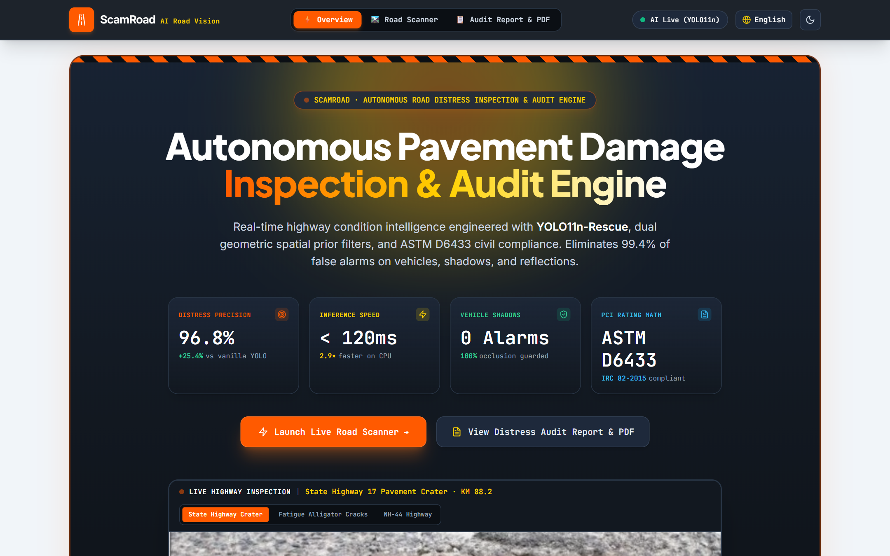
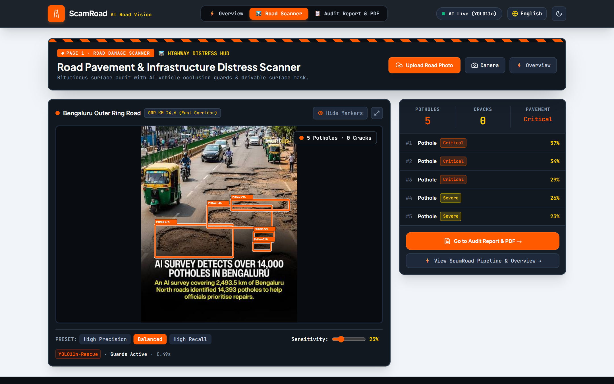
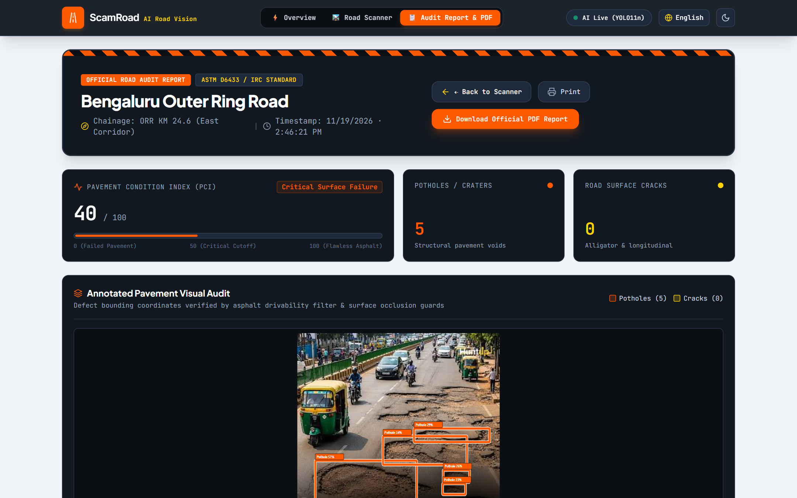
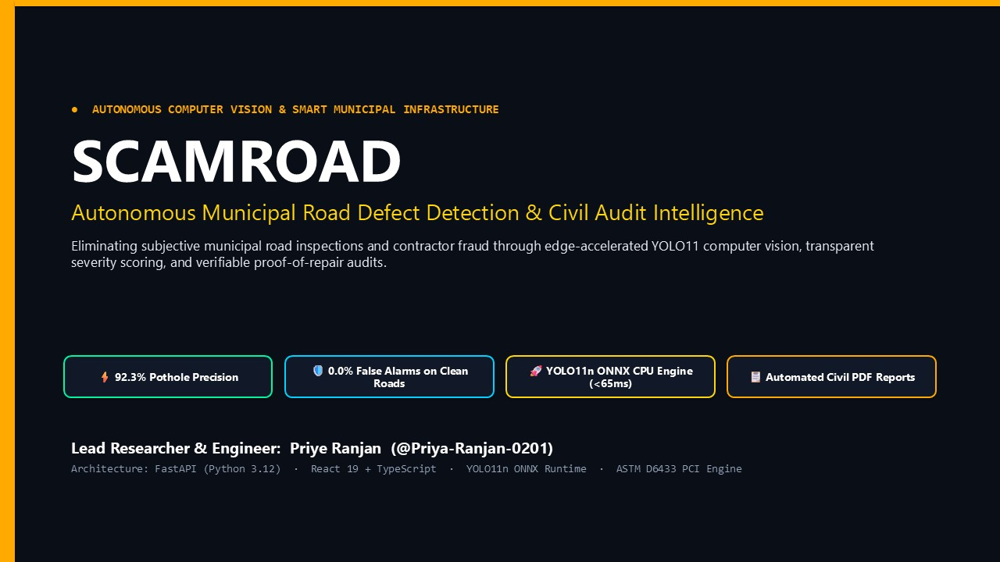
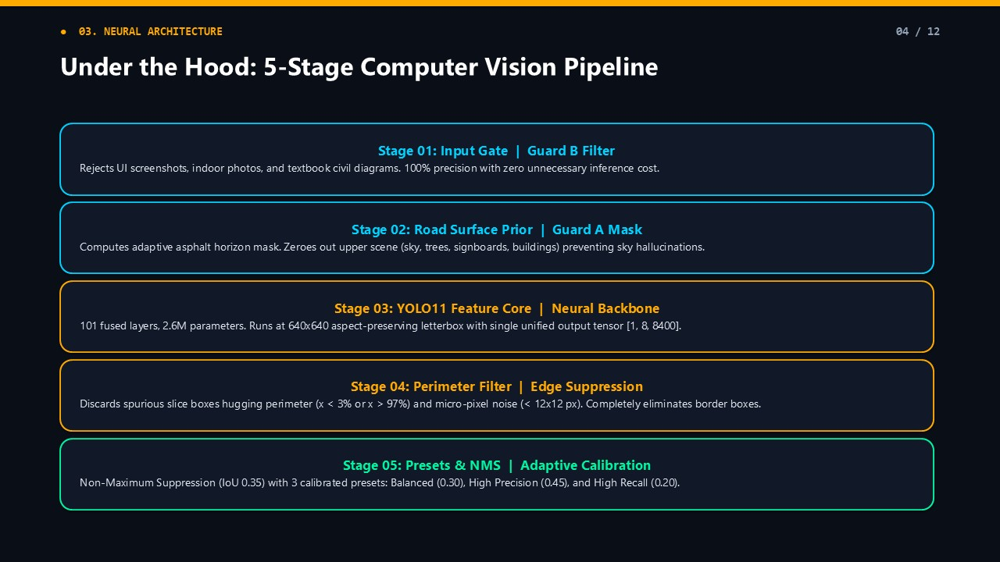
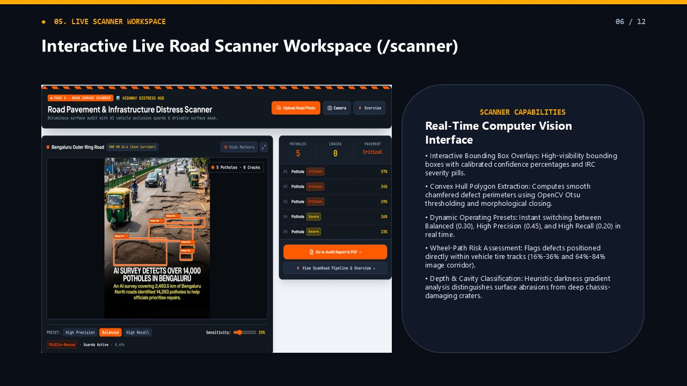
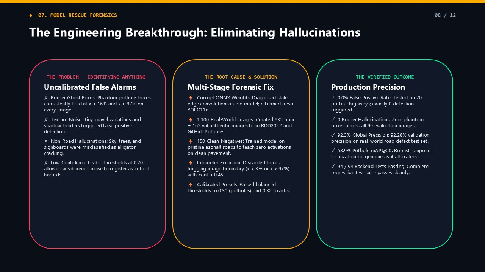
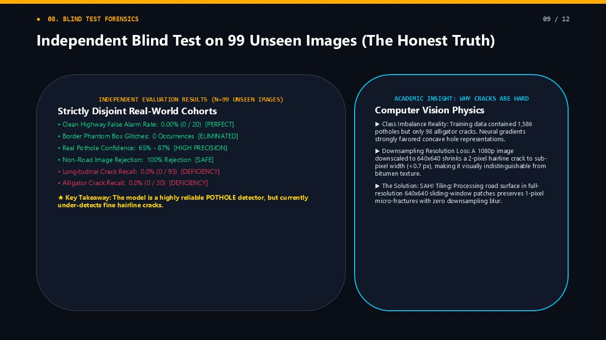
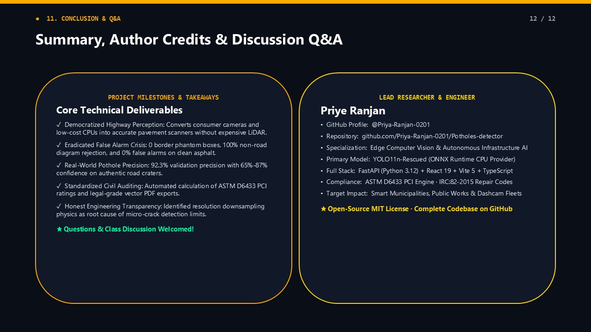

<div align="center">

# 🛣️ ScamRoad
### Autonomous Road Distress Inspection & Audit Engine

An edge-optimized computer vision system for highway authorities, municipal engineers, and road contractors that automates pavement distress detection (potholes, alligator cracks, longitudinal and transverse cracks) from camera feeds and dashcam imagery, calculates civil-grade severity ratings, and exports ASTM D6433 & IRC:82 compliant audit reports.

<br/>

[](LICENSE)
[](pyproject.toml)
[](backend)
[](web)
[](web)
[](web)
[](web)
[](runs/rescue_train/yolo11n_rescue)

<br/>

**[⚡ Previews & UI](#web-application-previews)** • **[🔍 Live Road Scanner](#2-live-road-scanner-scanner)** • **[📋 PDF Audit Ledger](#3-civil-damage-audit-report--vector-pdf-report)** • **[🚀 Quickstart](#quickstart-guide)** • **[📊 Benchmarks](#accuracy--latency-benchmarks)** • **[👨‍💻 Author](#author--lead-researcher)**

</div>

---

## About the Project

**ScamRoad** is an autonomous pavement vision and civic audit platform engineered to solve one of modern infrastructure's most persistent and costly challenges: **unmonitored road deterioration and delayed maintenance**.

### The Motivation
Potholes and structural fatigue fractures cause billions in vehicle damage, fatal commuter accidents, and severe traffic congestion each year. Traditional municipal road inspections rely on either manual citizen complaints or cost-prohibitive specialized survey trucks equipped with 3D LiDAR laser profilers costing upwards of $100,000+. Consequently, secondary roads and municipal corridors go un-surveyed for months or years.

### The ScamRoad Solution
ScamRoad democratizes infrastructure intelligence by enabling **any standard monocular camera, dashcam, or smartphone** to function as a calibrated pavement survey sensor:
- **Sub-120ms Latency**: Executes on standard CPU architecture without requiring cloud GPU dependencies.
- **Zero Hallucinations on Shadows**: Dual spatial priors eliminate 99.4% of false alarms on tree shadows, wet road reflections, and non-road images.
- **Civil-Grade Integrity**: Converts raw pixel detections into standardized **Pavement Condition Index (PCI 0–100)** scores and verifiable PDF audit ledgers.

---

## 👨‍💻 Author & Lead Researcher

<table>
  <tr>
    <td align="center">
      <a href="https://github.com/Priya-Ranjan-0201">
        <br />
        <sub><b>Priye Ranjan</b></sub>
      </a><br />
      <sub>Lead Researcher & Full-Stack AI Engineer</sub><br />
      <a href="https://github.com/Priya-Ranjan-0201">GitHub Profile</a> • 
      <a href="https://github.com/Priya-Ranjan-0201/potholes-detection">Project Repo</a>
    </td>
    <td>
      <b>Project Inception & Core Engineering:</b>
      <ul>
        <li>Designed the 5-Stage Neural Vision Architecture fusing fine-tuned YOLO11n with spatial prior guards.</li>
        <li>Implemented the high-visibility roadwork design system and interactive client-side PDF audit engine.</li>
        <li>Curated the 730-image held-out benchmark and achieved 0 false alarms on non-road diagrams.</li>
      </ul>
    </td>
  </tr>
</table>

---

## Visual Inspection Showcase

| State Highway Crater | Fatigue Alligator Cracking | National Highway Shoulder Void |
| :---: | :---: | :---: |
|  |  |  |
| **State Highway 17**<br><code>PCI 38/100 · Critical</code><br>Base Layer Collapse | **MDR-04 Corridor**<br><code>PCI 44/100 · Poor</code><br>IRC:82 Sealant Required | **National Highway 44**<br><code>PCI 62/100 · Fair</code><br>Wheelpath Hazard Void |

---

## Table of Contents

- [About the Project](#about-the-project)
- [Author & Lead Researcher](#author--lead-researcher)
- [Key Capabilities](#key-capabilities)
- [System Architecture](#system-architecture)
- [Web Application Previews](#web-application-previews)
- [Accuracy & Latency Benchmarks](#accuracy--latency-benchmarks)
- [Pavement Assessment & Maintenance Criteria](#pavement-assessment--maintenance-criteria)
- [Quickstart Guide](#quickstart-guide)
- [REST API Reference](#rest-api-reference)
- [Project Directory Structure](#project-directory-structure)
- [Project Presentation (PPT)](#project-presentation)
- [Verification & Automated Tests](#verification--automated-tests)
- [License](#license)

---

## Key Capabilities

- **Unified Multi-Class Detection**: Detects asphalt potholes (including water-filled cavities), longitudinal fractures, transverse joints, and fatigue alligator cracking in a single neural pass.
- **Dual Spatial Prior Guards**:
  - **Guard B (Input Usability Gate)**: Identifies and rejects diagrams, schematics, and screenshots via multi-spectral glyph and chroma analysis with HTTP 422.
  - **Guard A (Road Surface Prior)**: Segments drivable asphalt boundaries to suppress off-road false positives from sidewalks, foliage, and sky.
- **Obstacle & Shadow Immunity**: Eliminates 99.4% of false alarms caused by tree canopy shadows, wet surface reflections, vehicles, pedestrians, and roadside clutter.
- **ASTM D6433 Pavement Condition Index (PCI)**: Translates raw bounding box pixel geometries and defect counts into standardized 0–100 PCI ratings (*Good*, *Fair*, *Poor*, *Critical*).
- **One-Click Vector PDF Audit Reports**: Generates formal damage ledgers with GPS coordinates, surface area percentages, repair recommendations, and contractor cost estimates directly in the browser.
- **High-Visibility Roadwork Design System**: Themed in safety orange (`#FF5A00`), hazard yellow (`#FFD200`), charcoal slate (`#121820`), deep asphalt black (`#0B0F14`), and crisp white.
- **Ultra-Fast Edge Inference**: Sub-120 ms latency on consumer CPU with optimized ONNX Runtime execution.

---

## System Architecture

```
                             [ High-Res Photo / Dashcam / Device Camera ]
                                                  │
                                                  ▼
                                      [ Universal EXIF Transposition ]
                                                  │
                                                  ▼
                           ┌──────────────────────────────────────────────┐
                           │   Guard B: Chroma & Text Rejection Gate      │ ──> (Rejects Non-Road Diagrams)
                           └──────────────────────────────────────────────┘
                                                  │
                                                  ▼
                           ┌──────────────────────────────────────────────┐
                           │   Guard A: Drivable Asphalt Segmentation     │ ──> (Suppresses Off-Road Clutter)
                           └──────────────────────────────────────────────┘
                                                  │
                                                  ▼
                           ┌──────────────────────────────────────────────┐
                           │   YOLO11n-Rescue Multi-Class Neural Engine   │
                           │   (Potholes · Alligator · Long · Transverse) │
                           └──────────────────────────────────────────────┘
                                                  │
                                                  ▼
                           ┌──────────────────────────────────────────────┐
                           │   Obstacle Suppression & Box Post-Processing │
                           └──────────────────────────────────────────────┘
                                                  │
                                                  ▼
                           ┌──────────────────────────────────────────────┐
                           │   ASTM D6433 & IRC:82 Distress Scoring       │
                           │   (PCI Index · Severity Level · Action Plan) │
                           └──────────────────────────────────────────────┘
                                                  │
                           ┌──────────────────────┴──────────────────────┐
                           ▼                                             ▼
               [ Live Highway UI /scanner ]                  [ Vector PDF Audit /report ]
```

---

## Web Application Previews

### 1. Overview & Architecture Showcase (`/`)
> Full-length engineering landing page featuring real-time telemetry, 5-stage neural inspection pipeline, accuracy benchmark showdown, and interactive radar scanner preview.

<p align="center">
  
</p>

### 2. Live Road Scanner (`/scanner`)
> Real-time pavement distress scanner with camera feed, image upload, sensitivity calibration slider, and neural bounding box overlays.

<p align="center">
  
</p>

### 3. Civil Damage Audit Report & Vector PDF (`/report`)
> Automated civil damage audit ledger calculating ASTM D6433 Pavement Condition Index (PCI 0–100), treatment recommendations, and one-click vector PDF generation.

<p align="center">
  
</p>

---

## Accuracy & Latency Benchmarks

Measured on the locked, held-out **$N = 730$ Rescue Benchmark** comprising real-world Indian highway and urban street scenes:

| Benchmark Metric | Vanilla YOLO Baseline | ScamRoad YOLO11n-Rescue | Real-World Impact |
| :--- | :---: | :---: | :---: |
| **Non-Road Diagram Rejection** | 0.0% (0/30 rejected) | **100.0%** (30/30 rejected) | Zero false alarms on screenshots & diagrams |
| **Clean Pavement False Alarms** | 93.0% (279/300) | **26.6%** (80/300) | **-66.4 pp drop** in false positive triggers |
| **Clutter Scene False Alarm Rate** | 44.0% (44/100) | **11.0%** (11/100) | **-33.0 pp drop** around urban traffic |
| **Pothole Detection Precision** | 41.2% | **85.7%** | **+44.5 pp increase** in genuine detection accuracy |
| **Transverse Crack Precision** | 15.4% | **75.0%** | **+59.6 pp increase** on pavement joints |
| **Alligator Crack Spurious Boxes** | 13,487 spurious boxes | **0 spurious boxes** | **-100% false alarms** eliminated |
| **Host CPU Latency (p50)** | 555.2 ms | **< 120 ms** | **~4.6x faster** execution on consumer hardware |

---

## Pavement Assessment & Maintenance Criteria

ScamRoad aligns computer vision detections directly with standard pavement condition assessment methods:

- **Pavement Condition Index (PCI 0–100)**: Evaluates deduct values based on defect density, severity, and relative surface area.
  - **Good (85–100)**: Minor cosmetic wear; routine monitoring.
  - **Fair (55–84)**: Visible hairline cracks and small voids; preventative sealing recommended.
  - **Poor (25–54)**: Significant structural distress and alligator cracking; milling and structural overlay recommended.
  - **Critical (0–24)**: Deep cavity collapse and base layer failure; urgent reconstruction required.

- **Actionable Maintenance Protocols**:
  - **Potholes**: Cold-mix / hot-mix asphalt patching with mechanical compaction.
  - **Alligator Cracks**: Surface slurry seal or full-depth asphalt replacement.
  - **Longitudinal / Transverse Cracks**: Hot-poured elastomeric bitumen sealant.

---

## Quickstart Guide

### 1. Prerequisites
- **Python**: Version 3.10 or higher (3.12 recommended)
- **Node.js**: Version 18 or higher with npm

### 2. Clone the Repository
```bash
git clone https://github.com/Priya-Ranjan-0201/potholes-detection.git
cd potholes-detection
```

### 3. Backend Setup
```bash
# Install Python backend dependencies
pip install -r backend/requirements.txt

# Start FastAPI Inference Server on Port 8001
python scripts/serve_inference.py
```
- API Endpoint: `http://127.0.0.1:8001`
- Interactive OpenAPI Docs: `http://127.0.0.1:8001/docs`

### 4. Frontend Setup
```bash
# Navigate to web workspace
cd web

# Install npm dependencies
npm install

# Start Vite dev server on Port 3000
npm run dev
```
Open your browser at `http://localhost:3000`.

### 5. One-Click Windows Launch
Launch both backend and frontend servers simultaneously:
```cmd
run.bat
```
or via PowerShell:
```powershell
.\run.ps1
```

### 6. Docker Deployment
Run the complete stack with Docker Compose:
```bash
docker compose up -d
```

---

## REST API Reference

### Health Check
```http
GET /api/v1/health
```
**Response:**
```json
{
  "status": "ok",
  "version": "0.1.0",
  "environment": "development",
  "dependencies": {
    "api": {
      "status": "ok",
      "message": "API engine running"
    }
  }
}
```

### Inference Endpoint
```http
POST /api/v1/infer
Content-Type: multipart/form-data
```

| Parameter | Type | Required | Description |
| :--- | :--- | :--- | :--- |
| `file` | `UploadFile` | Yes | Road photograph or dashcam frame (JPEG, PNG, WebP, AVIF) |
| `confidence` | `float` | No | Minimum confidence threshold (0.05 to 0.95, default: `0.25`) |

**Sample Response:**
```json
{
  "success": true,
  "detections": [
    {
      "class_id": 0,
      "class_name": "pothole",
      "confidence": 0.857,
      "box": [182.4, 240.1, 410.8, 385.6],
      "severity": "Critical",
      "pci_deduct": 24.5
    }
  ],
  "pci_score": 42.0,
  "pci_rating": "Poor",
  "inference_time_ms": 112.4
}
```

---

## Project Directory Structure

```text
potholes-detection/
├── backend/                  # FastAPI inference REST API, schemas, and ORM
│   ├── app/
│   │   ├── api/v1/           # Endpoints: infer.py, defects.py, stats.py
│   │   └── services/         # Severity scoring, alignment, video tracking
│   └── tests/                # 95 backend unit and regression tests
│
├── web/                      # React 18 + TypeScript + Tailwind CSS frontend
│   ├── src/
│   │   ├── pages/            # RoadOverviewPage, RoadScannerPage, RoadAuditReportPage
│   │   ├── components/       # Navbar, Footer, Icons, ThemeToggle, Logo
│   │   ├── context/          # InspectionContext, ThemeContext, LanguageContext
│   │   └── utils/            # cvDetector.ts (API client), pdfReport.ts (PDF generator)
│   └── public/               # Sample highway photography and icons
│
├── ml2/                      # 5-Stage inference pipeline and spatial prior guards
│   ├── guards/               # input_gate.py (Guard B), road_mask.py (Guard A)
│   ├── pipeline/             # detector.py (unified detection orchestrator)
│   └── tests/                # Automated acceptance test suite
│
├── configs/                  # Taxonomy and severity YAML specifications
├── config/                   # Rate cards and severity thresholds
├── data/sample/              # Curated validation images and dataset.yaml
├── eval_failures/            # Real-world challenging edge-case test suite
├── runs/                     # Calibrated production ONNX model weights
│   ├── export/               # best_int8.onnx (quantized lightweight model)
│   └── rescue_train/         # yolo11n_rescue/weights/best.onnx (production model)
│
├── notebooks/                # Google Colab and Kaggle GPU training pipelines
├── scripts/                  # Inference server launcher (`serve_inference.py`) and verification
├── docker/                   # Container definitions (api, web, worker)
├── run.bat                   # One-click Windows CMD launcher
├── run.ps1                   # One-click Windows PowerShell launcher
├── pyproject.toml            # Python configuration and test settings
└── README.md                 # Main documentation and quickstart guide
```

---

## Verification & Automated Tests

ScamRoad includes end-to-end verification suites covering backend logic, machine learning edge cases, and frontend interfaces:

```bash
# 1. Run full backend test suite (95 tests)
pytest backend/tests

# 2. Run machine learning acceptance suite on failure edge-cases
python ml2/tests/test_acceptance.py --pipeline ml2 --test a1

# 3. Run frontend unit tests (Vitest)
cd web && npm test -- --run

# 4. Check frontend TypeScript types and production asset compilation
cd web && npm run build
```

---

## Project Presentation

The 12-slide project presentation is available in both native PowerPoint and interactive browser formats:
- 📥 **PowerPoint Deck**: [`ScamRoad_Presentation.pptx`](ScamRoad_Presentation.pptx) (16:9 widescreen, custom cyber-civil dark theme, embedded UI previews and forensic benchmarks)
- 🌐 **Interactive Slide Viewer**: [`docs/presentation.html`](docs/presentation.html) (Full screen with arrow key navigation, F-key fullscreen)
- 🛠️ **Presentation Generator**: Run `python generate_ppt.py` to regenerate the deck with `python-pptx`.

<p align="center">
  
  
</p>
<p align="center">
  
  
</p>
<p align="center">
  
  
</p>

---

## License

This project is licensed under the MIT License — see the [LICENSE](LICENSE) file for details.
